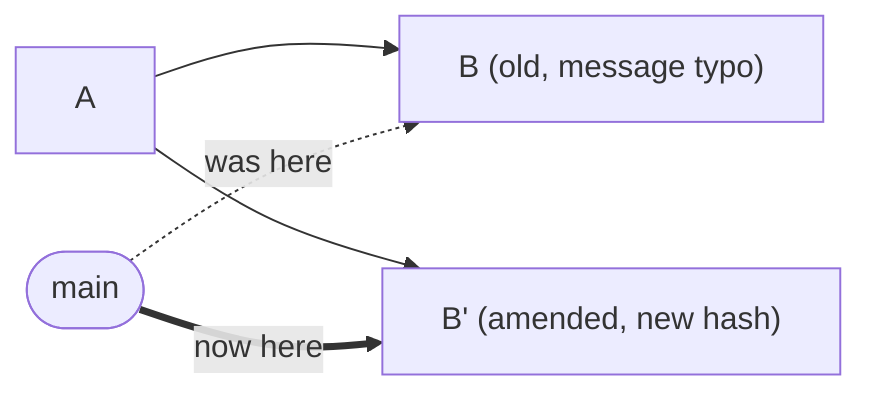

# Lesson 06 — Amending Commits

> **Module 02 — Inspecting & Undoing Changes** · Book 07 — Git & GitHub

## 🎯 Learning Objectives

By the end of this lesson you will be able to:

- Fix the **last commit's message** with `git commit --amend`
- Add a forgotten file or change to the last commit
- Change the author or date of the last commit
- Explain why an amended commit is a **new** commit with a new hash
- Apply the **golden rule**: never amend commits that others already have

---

## 📖 Introduction

You commit, and a second later you notice a typo in the message, or a file you forgot to add. Making a second commit called "fix typo" clutters history. `git commit --amend` lets you **redo the last commit** instead.

It is the first of the "rewrite history" tools. It is perfectly safe while the commit is only on your machine. Used on shared commits it causes real trouble, so the rules matter as much as the command.

---

## 1. Amend the Message

```bash
git commit --amend
```

Your editor opens with the previous message. Edit, save, close. Or in one line:

```bash
git commit --amend -m "fix: correct the cart total calculation"
```

---

## 2. Add Forgotten Changes

```bash
git add forgotten-file.js          # stage what you forgot
git commit --amend --no-edit       # fold it into the last commit, keep the message
```

| Flag | Effect |
|---|---|
| `--no-edit` | Keep the existing message without opening the editor |
| `-m "..."` | Replace the message |
| `-a` | Also auto-stage modified tracked files first |
| `--author="Name <email>"` | Change the author |
| `--reset-author` | Reset author to your **current** configured identity (useful when the wrong email was used) |
| `--date="<date>"` | Set the author date |

### Fix a wrong email on the last commit

```bash
git config user.email "right@example.com"
git commit --amend --reset-author --no-edit
```

---

## 3. What Really Happens: A New Commit

A commit's hash is computed from its contents, message, author, timestamp **and parent**. Change any of that and the hash changes. So amending does **not** edit the commit. It **creates a replacement** and moves the branch to it.



The old commit `B` still exists for a while and can be recovered from the **reflog** (Lesson 08). Nothing is deleted immediately, but `main` no longer points at it.

---

## 4. The Golden Rule of History Rewriting

> **Never amend (or otherwise rewrite) commits that other people have already pulled.**

If you amended a commit that is already pushed and shared:

1. Your local `B'` differs from the remote's `B`.
2. A plain `git push` is rejected, because the histories have diverged.
3. Forcing it overwrites the shared history, and teammates who based work on `B` now have a conflicting copy.

| Situation | OK to amend? |
|---|---|
| The commit exists only on your machine | ✅ Yes |
| Pushed to **your own** feature branch, nobody else uses it | ⚠️ Yes, with a safe force push (`--force-with-lease`, Module 06) |
| Pushed to a **shared** branch (`main`, a teammate's branch) | ❌ No. Make a new commit or `git revert` (Lesson 07) |

---

## 5. Amend Only Reaches the Last Commit

`--amend` modifies the most recent commit only. To change an **older** commit:

- **Interactive rebase** (`git rebase -i`, Module 06) lets you reword, edit, squash or drop older commits.
- **Fixup commits**: `git commit --fixup=<hash>` records a correction to be folded in later with `git rebase -i --autosquash` (Module 06).

---

## 6. Undoing a Mistaken Amend

You amended and regret it. The pre-amend commit is still in the reflog (Lesson 08):

```bash
git reflog                       # find the entry before "commit (amend)"
git reset --hard HEAD@{1}        # go back to it (working tree should be clean first!)
```

Right after the amend, `HEAD@{1}` is the commit before it.

---

## 7. Amend vs a New Commit — Which to Use?

| Use `--amend` when... | Use a new commit when... |
|---|---|
| It is a typo, forgotten file or tiny correction to the **last** commit | The commit is already shared |
| The commit is local only | The fix is a meaningful, separate change |
| You want history to read cleanly | You want to keep an honest trail of what happened |

---

## 🛠️ Practical Example — Fix the Last Commit

```bash
mkdir -p ~/git-practice && cd ~/git-practice
rm -rf amend-lab && mkdir amend-lab && cd amend-lab
git init -b main

echo "<h1>Shop</h1>" > index.html
git add index.html
git commit -m "feat: add shop pge"        # typo in message AND a file is missing
git log --oneline
```

### Step 1 — fix the typo

```bash
git commit --amend -m "feat: add shop page"
git log --oneline          # note the hash is different now
```

### Step 2 — add the forgotten file

```bash
echo "body { margin: 0; }" > styles.css
git add styles.css
git commit --amend --no-edit
git show --stat
```

### Step 3 — compare hashes

```bash
git reflog
```

Find the three entries: the original commit, the first amend and the second amend. Each has a different hash.

### Step 4 — undo the last amend

```bash
git reset --hard HEAD@{1}
git show --stat            # styles.css is no longer in the commit
```

(Run `git reflog` again and notice that reset is recorded too.)

**Checkpoint tasks:**

1. Why does the hash change when you amend?
2. You amended a commit that is already on `origin/main`. What should you do?
3. How do you keep the message but add a forgotten file?

<details>
<summary>Show answers</summary>

1. The hash covers the commit's content, message, author, date and parent. Amending changes at least some of these, so a new commit is created.
2. Do not push the rewrite. Reset to the original with the reflog (`git reset --hard origin/main` if you have no other work), and make a normal new commit or `git revert`.
3. `git add <file>` then `git commit --amend --no-edit`.
</details>

---

## 📝 Revision Questions

**1. What does `git commit --amend` do?**

<details>
<summary>Show answer</summary>

It replaces the most recent commit with a new one that includes any staged changes and/or a new message, then moves the branch to it.
</details>

**2. Does amending edit the old commit in place?**

<details>
<summary>Show answer</summary>

No. It creates a brand-new commit with a different hash. The old commit remains in the reflog for a while.
</details>

**3. Why is amending a pushed commit a problem?**

<details>
<summary>Show answer</summary>

It rewrites history that others may already have. The remote and your local branch diverge, and force-pushing can overwrite teammates' work or leave them with conflicting copies.
</details>

**4. How do you fix an older (not the last) commit?**

<details>
<summary>Show answer</summary>

Use interactive rebase (`git rebase -i`) or a fixup commit with `--autosquash`, both covered in Module 06.
</details>

**5. How can you recover the version before an accidental amend?**

<details>
<summary>Show answer</summary>

Find it in `git reflog` and run `git reset --hard HEAD@{1}` (or the specific reflog entry), after making sure your working tree is clean.
</details>

---

➡️ **Next:** Lesson 07 — Reset Demystified and Revert
