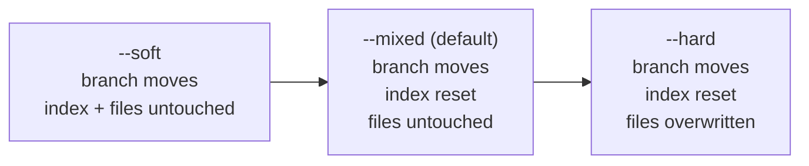
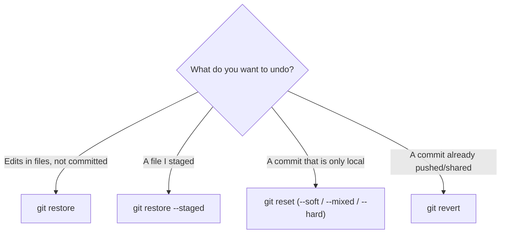

# Lesson 07 — Reset Demystified and Revert

> **Module 02 — Inspecting & Undoing Changes** · Book 07 — Git & GitHub

## 🎯 Learning Objectives

By the end of this lesson you will be able to:

- Explain exactly what `git reset` does in its **three steps**
- Choose between `--soft`, `--mixed` and `--hard`
- Use `git reset` on files (unstaging) versus on commits
- Undo a commit **safely on shared history** with `git revert`, including merges
- Decide between `reset`, `revert` and `restore` for any situation

---

## 📖 Introduction

`git reset` has a reputation as the scariest Git command, mostly because nobody explains it with the right mental model. You already own that model from Module 01: **three areas**. `reset` is simply a tool for moving things between them.

Once the model is clear, `reset` becomes predictable. Then you will meet its safe counterpart, `git revert`, which undoes work **without rewriting history**.

---

## 1. The Three Things Reset Can Move

| Name | What it is |
|---|---|
| **HEAD / branch** | The commit your current branch points to |
| **Index** | The staging area (what the next commit would contain) |
| **Working tree** | The files on disk |

`git reset <commit>` performs up to **three steps**, stopping early depending on the mode:

1. **Move** the current branch (and HEAD) to `<commit>`
2. **Update the index** to match that commit
3. **Update the working tree** to match that commit

| Mode | Step 1: move branch | Step 2: reset index | Step 3: reset working tree |
|---|:---:|:---:|:---:|
| `--soft` | ✅ | ❌ | ❌ |
| `--mixed` (**default**) | ✅ | ✅ | ❌ |
| `--hard` | ✅ | ✅ | ✅ |



---

## 2. The Three Modes in Practice

Imagine you made commits `A → B → C` (HEAD at `C`) and run `git reset <A>`-style commands:

### `--soft`: "undo the commit, keep everything staged"

```bash
git reset --soft HEAD~1
```

The branch moves back one commit. Your changes from that commit are now **staged**. Perfect for redoing a commit, or **squashing** commits:

```bash
git reset --soft HEAD~3     # combine the last 3 commits into one
git commit -m "feat: add checkout flow"
```

### `--mixed` (default): "undo the commit and the staging"

```bash
git reset HEAD~1            # same as --mixed
```

The branch moves back and the index resets, but your **files keep the changes**, now shown as *unstaged*. Perfect for "I committed too early, let me re-stage differently".

### `--hard`: "throw it all away"

```bash
git reset --hard HEAD~1
```

Branch, index **and working tree** all go back. Every uncommitted change is **destroyed**.

> 🚨 `--hard` is the dangerous one. Committed work can be rescued through the reflog (Lesson 08), but **uncommitted changes are gone for good**. Always run `git status` first.

### The safer cousins

| Mode | Behaviour |
|---|---|
| `--keep` | Like `--hard`, but **aborts** if it would overwrite local uncommitted changes |
| `--merge` | Resets and keeps changes that were not part of a conflicted merge |

When in doubt, `git reset --keep <commit>` is a hard reset with a seatbelt.

---

## 3. Reset With Paths: Unstaging Files

When you give `reset` a **path**, it does **not** move the branch. It only does step 2 (update the index) for those files:

```bash
git reset -- index.html          # unstage index.html
git reset HEAD -- index.html     # same
git reset <commit> -- app.js     # put app.js as of <commit> into the index
```

This is the old way to unstage. Today `git restore --staged` (Lesson 05) says the same thing more clearly. `--hard` cannot be combined with paths.

---

## 4. `ORIG_HEAD`: The Built-In Undo

Before a risky move, Git records where HEAD was in `ORIG_HEAD`.

```bash
git reset --hard HEAD~3        # oops
git reset --hard ORIG_HEAD     # back to where you were
```

It is overwritten by the next such operation, so use it immediately. The reflog (Lesson 08) is the long-term version.

---

## 5. Undoing Safely: `git revert`

`reset` rewrites history by moving a branch backwards. That is fine locally and wrong for commits others already have.

**`git revert` creates a NEW commit that applies the opposite changes.** History keeps growing; nothing is rewritten.


```bash
git revert <commit>              # opens the editor for the message
git revert <commit> --no-edit    # accept the default message
git revert HEAD                  # undo the most recent commit
```

The default message reads `Revert "original message"` and includes the original hash.

### Useful options

| Option | Effect |
|---|---|
| `-n` / `--no-commit` | Apply the reversal to your working tree/index without committing (combine several reverts into one commit) |
| `--no-edit` | Use the default message |
| `-m <parent-number>` | Required when reverting a **merge commit** |
| `--continue` / `--abort` / `--skip` | Manage a revert that hit a conflict |

### Reverting several commits

```bash
git revert OLDEST..NEWEST        # reverts each commit after OLDEST up to NEWEST, newest first
git revert -n OLDEST..NEWEST     # same, but gather them into a single commit
```

### Conflicts

If later commits changed the same lines, Git stops with a conflict. Fix the files (Module 03), `git add` them, then `git revert --continue`, or give up with `git revert --abort`.

---

## 6. Reverting a Merge Commit

A merge has two parents, so Git cannot know which side to keep. Tell it with `-m`:

```bash
git revert -m 1 <merge-commit>      # keep parent 1 (usually the branch you merged INTO)
```

> ⚠️ **Gotcha:** after reverting a merge, Git considers that branch's changes as "already merged and undone". Merging the same branch again later will **not** bring those changes back. To re-merge, first **revert the revert** (`git revert <the-revert-commit>`). This is a classic senior-level interview question.

---

## 7. Reset vs Revert vs Restore

| | `git restore` | `git reset` | `git revert` |
|---|---|---|---|
| Works on | **Files** | **Branch pointer** (and optionally index/files) | **A commit** |
| Changes history? | No | ✅ Yes (moves branch) | ❌ No (adds a commit) |
| Safe on shared branches? | n/a (local files) | ❌ No | ✅ Yes |
| Typical use | Discard edits, unstage | Undo local commits, squash | Undo a pushed commit |

### Decision guide



---

## 🛠️ Practical Example — Four Commits, Three Resets, One Revert

```bash
mkdir -p ~/git-practice && cd ~/git-practice
rm -rf reset-lab && mkdir reset-lab && cd reset-lab
git init -b main

for n in 1 2 3 4; do
  echo "line $n" >> notes.txt
  git add notes.txt
  git commit -q -m "add line $n"
done
git log --oneline
```

### Experiment 1 — `--soft`

```bash
git reset --soft HEAD~2
git status -s            # notes.txt staged (M )
git log --oneline        # only 2 commits left
git commit -m "add lines 3 and 4 together"
```

### Experiment 2 — `--mixed`

```bash
git reset HEAD~1
git status -s            # " M notes.txt": changes kept, NOT staged
git diff
git add notes.txt && git commit -q -m "re-commit"
```

### Experiment 3 — `--hard` and the way back

```bash
echo "uncommitted junk" >> notes.txt
git reset --hard HEAD~1
git status -s            # clean: the junk is gone forever
cat notes.txt
git reset --hard ORIG_HEAD   # committed work comes back; the "junk" does NOT
cat notes.txt
```

### Experiment 4 — revert

```bash
git log --oneline
git revert HEAD --no-edit
git log --oneline        # a new "Revert ..." commit on top
```

**Checkpoint tasks:**

1. After `git reset --soft HEAD~1`, where are the undone changes?
2. After `git reset HEAD~1`, where are they?
3. After `git reset --hard HEAD~1`?
4. Which would you use to undo a commit that is on `origin/main`?
5. Why did the "uncommitted junk" not come back in experiment 3?

<details>
<summary>Show answers</summary>

1. Staged in the index.
2. In the working tree, unstaged.
3. Nowhere (discarded from the index and working tree). The commit itself is still recoverable via the reflog.
4. `git revert` (it adds a new commit and does not rewrite shared history).
5. It was never committed or staged, so Git had no copy of it.
</details>

---

## 📝 Revision Questions

**1. What are the three steps of `git reset`?**

<details>
<summary>Show answer</summary>

Move the branch/HEAD to the target commit, update the index to match it, and update the working tree to match it. `--soft` stops after step 1, `--mixed` after step 2, `--hard` does all three.
</details>

**2. How do you combine the last three commits into one using reset?**

<details>
<summary>Show answer</summary>

`git reset --soft HEAD~3` then `git commit -m "message"`. The changes of all three stay staged, so one new commit captures them.
</details>

**3. Why is `git revert` safe on shared branches?**

<details>
<summary>Show answer</summary>

It adds a new commit that reverses the changes instead of moving the branch backwards, so history is never rewritten and teammates' copies stay compatible.
</details>

**4. How do you revert a merge commit, and what is the catch?**

<details>
<summary>Show answer</summary>

`git revert -m 1 <merge>` (choose the parent to keep). Afterwards Git treats the branch as already merged, so merging it again will not re-apply the reverted changes. You must revert the revert first.
</details>

**5. What does `git reset --keep` add over `--hard`?**

<details>
<summary>Show answer</summary>

It refuses to run if it would overwrite uncommitted local changes, so you cannot lose them by accident.
</details>

---

➡️ **Next:** Lesson 08 — Reflog and Recovery
