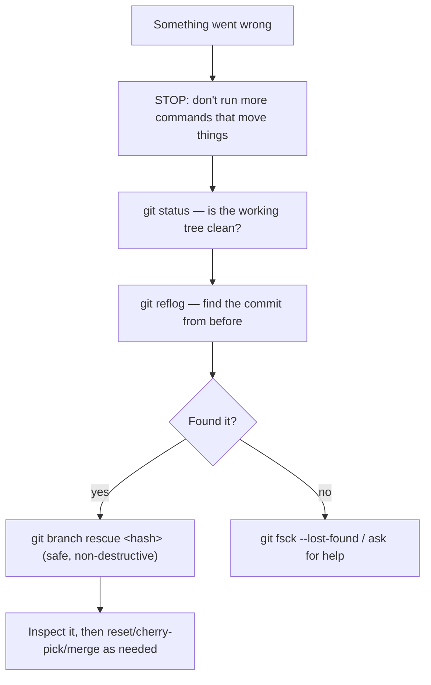

# Lesson 08 — Reflog and Recovery

> **Module 02 — Inspecting & Undoing Changes** · Book 07 — Git & GitHub

## 🎯 Learning Objectives

By the end of this lesson you will be able to:

- Explain what the **reflog** records and why it makes Git forgiving
- Read `git reflog` output and use `HEAD@{n}` and time-based references
- Recover from a bad `reset --hard`, a deleted branch, a bad amend, rebase or merge
- Recover a dropped stash
- Know what **cannot** be recovered, and follow a calm recovery playbook

---

## 📖 Introduction

Git feels dangerous because commands like `reset --hard`, `branch -D` and `rebase` seem to destroy work. Here is the secret that makes Git far safer than it looks:

> **Git almost never deletes commits right away.** It just stops pointing at them.

The **reflog** is the logbook of everywhere your branch tips and HEAD have been. If you can find a commit's hash in it, you can get the commit back. This lesson turns "I lost my work!" into a five-minute routine.

---

## 1. What Is the Reflog?

Every time **HEAD** or a **branch tip** moves (commit, checkout, merge, rebase, reset, amend, pull...), Git writes an entry in a local log.

```bash
git reflog
```

```
d4e8f21 (HEAD -> main) HEAD@{0}: reset: moving to HEAD~2
a91c3b7 HEAD@{1}: commit: feat: add checkout
7c2b9e4 HEAD@{2}: commit: feat: add cart
3f1a0d8 HEAD@{3}: commit (initial): feat: initial commit
```

| Part | Meaning |
|---|---|
| `a91c3b7` | The commit HEAD pointed to at that moment |
| `HEAD@{1}` | "Where HEAD was one move ago" |
| `commit:`, `reset:`, `checkout:`... | The action that moved it |

### Key facts

- The reflog is **local**. It is not pushed, and a fresh clone has none.
- It records **where things pointed**, not file contents.
- Entries expire: by default **90 days** for reachable commits and **30 days** for unreachable ones (`gc.reflogExpire`, `gc.reflogExpireUnreachable`).
- Each branch has its own reflog too: `git reflog show main`.

### `HEAD~1` versus `HEAD@{1}`

| Syntax | Meaning |
|---|---|
| `HEAD~1` | The **parent** of the current commit (ancestry) |
| `HEAD@{1}` | Where HEAD pointed **one move ago** (history of your actions) |

They are often different after a reset or checkout. When recovering, you want `@{n}`.

---

## 2. Time-Based References

```bash
git show HEAD@{yesterday}
git diff main@{"2 hours ago"} main
git reflog --date=relative
git log -g                       # reflog shown as a log
```

---

## 3. Recovery Recipes

### 3.1 Undo `git reset --hard`

```bash
git reset --hard HEAD~3          # oh no
git reflog                       # find the commit from before the reset
git reset --hard HEAD@{1}        # or: git reset --hard <hash>
```

If you reset just now, `git reset --hard ORIG_HEAD` also works (Lesson 07).

### 3.2 Recover a deleted branch

```bash
git branch -D feature/search     # deleted by mistake! Git prints its last hash
git branch -D feature/search
Deleted branch feature/search (was 7c2b9e4).
git branch feature/search 7c2b9e4        # recreate it at that commit
```

If you missed the printed hash, find the last commit on that branch in `git reflog` (look for `checkout: moving from feature/search to ...`).

### 3.3 Undo a bad amend

```bash
git reflog                       # entry before "commit (amend)"
git reset --hard HEAD@{1}
```

### 3.4 Undo a rebase (Module 06)

```bash
git reflog                       # find the line "rebase (start)" and the commit BEFORE it
git reset --hard <that-commit>
git reset --hard ORIG_HEAD       # works right after the rebase finishes
```

### 3.5 Undo a bad merge (not yet pushed)

```bash
git reset --hard ORIG_HEAD       # Git records ORIG_HEAD before merging
```

### 3.6 Recover a dropped stash (Module 03)

`git stash drop` and `git stash pop` print the hash of the stash they remove:

```
Dropped refs/stash@{0} (3f9c2a1d4e5b...)
```

Bring it back:

```bash
git stash apply 3f9c2a1d4e5b
# or:
git branch rescued-stash 3f9c2a1d4e5b
```

If you lost that hash, `git fsck --no-reflog --unreachable | grep commit` lists dangling commits (Module 07 explains `fsck`).

### 3.7 Recover work from a detached HEAD

You were on a detached HEAD, made commits, then switched away. Those commits sit only in the reflog:

```bash
git reflog
git switch -c rescued <hash>
```

---

## 4. Don't Panic: A Recovery Playbook



1. **Stop.** Do not run `git gc`, `git prune` or `git reflog expire`.
2. **Look.** `git reflog` and `git log --all --oneline`.
3. **Make a safety net.** `git branch rescue <hash>` creates a branch at the lost commit. It changes nothing else, and now nothing can garbage-collect it.
4. **Then repair.** Inspect with `git show`, `git switch`, `git cherry-pick`, or `git reset`.

> 💡 Creating a branch at a commit is the **safest first move**. It is non-destructive, instantly protects the commit, and lets you take your time.

---

## 5. What You Cannot Recover

| Lost thing | Why |
|---|---|
| **Uncommitted, never-staged edits** (e.g. after `git restore` or `reset --hard`) | Git never stored them |
| **Untracked files** deleted by `git clean` | Never tracked |
| **Commits past the expiry window** after `git gc` | Pruned from the database |
| **Anything on another machine's reflog** | The reflog is local |
| Anything after `git reflog expire --expire=now --all && git gc --prune=now` | You asked Git to forget |

> ⚠️ Never run the last command casually. It permanently removes everything not reachable from a branch or tag.

### Partial rescue: staged content

If you ran `git add` before losing a file's edits, the content exists as an object even if no commit references it. `git fsck --lost-found` (Module 07) can recover those "dangling blobs". It is a rescue operation, not something to rely on.

**Prevention beats recovery:** commit often (even WIP commits you tidy later), stash before risky operations, and push important branches.

---

## 🛠️ Practical Example — Create a Disaster, Then Fix It

```bash
mkdir -p ~/git-practice && cd ~/git-practice
rm -rf reflog-lab && mkdir reflog-lab && cd reflog-lab
git init -b main

for n in 1 2 3 4 5; do
  echo "feature $n" >> app.txt
  git add app.txt
  git commit -q -m "feat: feature $n"
done
git log --oneline
```

### Disaster 1 — hard reset

```bash
git reset --hard HEAD~3
git log --oneline            # only 2 commits... where did 3, 4, 5 go?
git reflog
git reset --hard HEAD@{1}
git log --oneline            # all five are back
```

### Disaster 2 — deleted branch

```bash
git switch -c feature/search
echo "search" > search.txt && git add . && git commit -q -m "feat: search"
git switch main
git branch -D feature/search      # note the printed hash
git branch feature/search <hash>
git switch feature/search && ls   # search.txt is back
git switch main
```

### Disaster 3 — bad amend

```bash
git commit --amend -m "oops, wrong message" --allow-empty
git reflog | head -5
git reset --hard HEAD@{1}
git log --oneline | head -3
```

### Disaster 4 — dropped stash

```bash
echo "precious edit" >> app.txt
git stash
git stash drop           # note the hash it prints
git stash apply <hash>
cat app.txt
```

**Checkpoint tasks:**

1. What is the difference between `HEAD~2` and `HEAD@{2}`?
2. Why is `git branch rescue <hash>` a good first recovery step?
3. After `git reset --hard`, which of these can you recover: (a) a committed change, (b) a staged but uncommitted change, (c) an unstaged edit?

<details>
<summary>Show answers</summary>

1. `HEAD~2` is the grandparent in the commit ancestry. `HEAD@{2}` is where HEAD pointed two movements ago, which depends on your actions.
2. It protects the lost commit from garbage collection and changes nothing else, so you can inspect it calmly before choosing a repair.
3. (a) yes, via the reflog. (b) possibly, as a dangling blob via `git fsck --lost-found` (Module 07). (c) no.
</details>

---

## 📝 Revision Questions

**1. What does the reflog record?**

<details>
<summary>Show answer</summary>

Every movement of HEAD and branch tips (commits, checkouts, merges, resets, rebases, amends...) in a local log, so you can find where things used to point.
</details>

**2. Is the reflog shared when you push or clone?**

<details>
<summary>Show answer</summary>

No. It is local to each repository on each machine. A fresh clone starts with an empty reflog.
</details>

**3. How do you recover a branch you deleted with `git branch -D`?**

<details>
<summary>Show answer</summary>

Find the last commit hash (printed at deletion or visible in `git reflog`) and run `git branch <name> <hash>`.
</details>

**4. After a bad rebase just finished, what is the quickest undo?**

<details>
<summary>Show answer</summary>

`git reset --hard ORIG_HEAD`, or find the pre-rebase commit in `git reflog` and reset to it.
</details>

**5. Name two things the reflog cannot bring back.**

<details>
<summary>Show answer</summary>

Uncommitted, never-staged edits, and untracked files removed by `git clean`. Also commits already pruned after the expiry window and `git gc`.
</details>

---

➡️ **Next:** Lesson 09 — Describe, Shortlog and Notes
